<!-- Generated by GitHub Profile Agent Console. Edit profile.config.json, then run npm run generate. -->

  <picture>
    <source media="(max-width: 760px) and (prefers-color-scheme: dark)" srcset="./assets/hero/agent-console-f2f475c0-mobile-dark.svg">
    <source media="(max-width: 760px)" srcset="./assets/hero/agent-console-f2f475c0-mobile-light.svg">
    <source media="(prefers-color-scheme: dark)" srcset="./assets/hero/agent-console-f2f475c0-dark.svg">
    <source media="(prefers-color-scheme: light)" srcset="./assets/hero/agent-console-f2f475c0-light.svg">
    
  </picture>

  

## About Me

I’m an Informatics student who combines software development, UI/UX design, and visual creativity to build functional, intuitive, and visually engaging digital experiences.

I enjoy turning ideas into reality through code and design, combining logical problem-solving with visual storytelling to create digital projects that are both functional and engaging.

## Current Focus

| Area | What I am exploring |
| --- | --- |
| **Software Development** | Building practical applications and software solutions through programming, problem-solving, and continuous experimentation. |
| **UI/UX Design** | Designing intuitive user interfaces and engaging user experiences by combining visual aesthetics, usability, and user-centered thinking. |
| **Graphic Design** | Creating compelling visual designs through thoughtful composition, typography, color theory, and consistent visual identity. |
| **Video Editing** | Editing video content through pacing, storytelling, sound design, and visual techniques to create engaging and polished results. |

## Featured Work

| Project | Focus | Why it matters |
| --- | --- | --- |
| [**Flawless Prison**](https://github.com/LyxzFlawless/FlawlessPrison) | Game Development | A Python-based 2D game built with Pygame, featuring interactive gameplay, challenges, and a boss battle. This project explores game development fundamentals, programming logic, and interactive design. |
| [**Cinema Ticket**](https://github.com/LyxzFlawless/Film) | C++ Application Development | A C++ console-based cinema ticket booking system that allows users to select movies, choose ticket quantities, calculate total prices, and repeat bookings through an interactive menu. |

## Research Direction

I’m interested in building digital experiences that combine software engineering, thoughtful UI/UX design, and visual creativity to solve real-world problems in intuitive and engaging ways.

## Tech Stack

`C++` · `Java` · `Python` · `SQL` · `SQLite` · `Git` · `GitHub` · `Pygame`

## Recent Activity

<!-- AUTO:ACTIVITY:START -->
- Oct 23, 2026: created a branch in [LyxzFlawless/LyxzFlawless](https://github.com/LyxzFlawless/LyxzFlawless).
- Oct 23, 2026: pushed 1 commit to [LyxzFlawless/LyxzFlawless](https://github.com/LyxzFlawless/LyxzFlawless).
<!-- AUTO:ACTIVITY:END -->

---

  Building ideas through code, design, and creativity.

